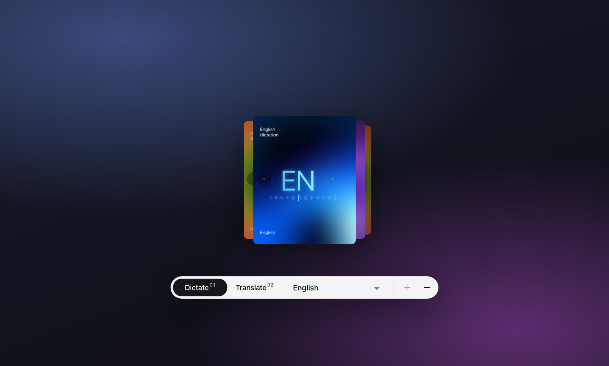
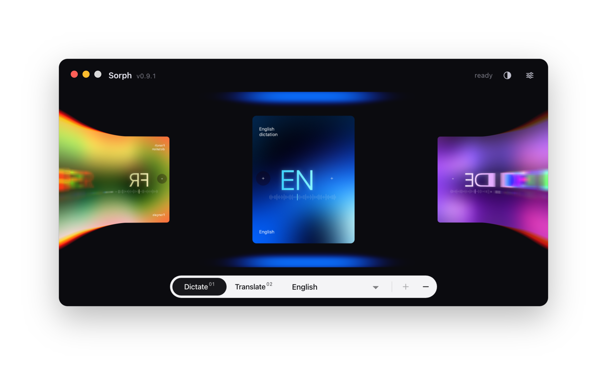

# v0.9.1 — Sorph, quietly

Thank you for using Sorph. This release makes the start quieter, makes
Muxpane hand-offs clearer, and fixes two things that showed up where
they shouldn't.

## A quieter start



- **A peek instead of a window.** When Sorph starts, it shows its cards
  as a small deck over your desktop for a few seconds and then fades
  away by itself. You no longer have to close a window every time you
  log in.
- **One click opens it all.** Click the deck, the language bar or a
  menu and the full window fades in around it. The deck spreads out
  into the gallery.



- **The card in use is always in front.** A quick key, or turning the
  gallery while it was still turning, could leave the wrong language in
  front. The gallery now always shows the language you are using.

## Muxpane

- **You can see where your words are going.** When you dictate to a
  Muxpane agent, the orb splits deep pink. A card above it names the
  agent, shows your words and says when they are sent.
- **Answer the moment an agent asks.** fn N twice in Muxpane brings up
  the pink orb and its card at once, ready for you to speak.

## Fixes

- **Saved words typed when you didn't say them.** If you trailed off at
  the end of a sentence ("it should take me to the..."), Sorph could
  add the words from your dictionary ("Sorph Singe CySA") as if you had
  said them. Now, when a dictation ends in your saved words, Sorph
  checks the audio once more and keeps them only if you said them.
- **A thin line round the startup cards.** macOS drew a window rim
  round the see-through startup view. It is gone.
- **No text field?** If you speak where there is nowhere to type, such
  as Finder or the desktop, Sorph plays a soft sound at your first
  words and puts what you said on the clipboard.
- **esbuild 0.25.12** for the dashboard's build (0.24.2 let any website
  read its development server). The dashboard runs the same code as
  before.

## Upgrading

One command, from anywhere, for any earlier version:

```bash
curl -fsSL https://raw.githubusercontent.com/TrenchStrAvy/Sorph-Local-Multilingual-Transcription/main/update.sh | zsh
```

Your permissions, settings, dictionary and models are kept. Nothing new
is downloaded.

## New install

```bash
git clone https://github.com/TrenchStrAvy/Sorph-Local-Multilingual-Transcription.git sorph
cd sorph && ./install.sh
```

Requires macOS and Python 3.10 or later. Full instructions are in the
[README](https://github.com/TrenchStrAvy/Sorph-Local-Multilingual-Transcription#readme).
